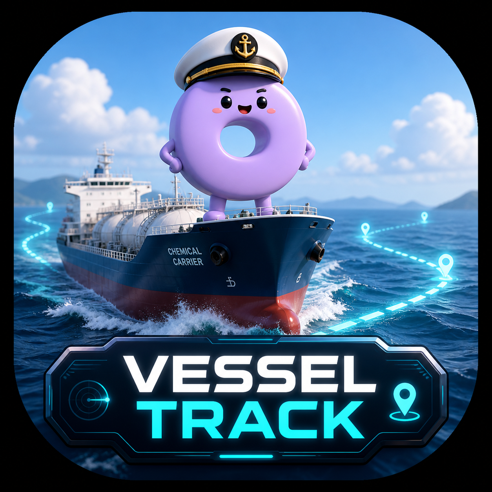

# 🚢 피클마린트래킹 (VESSEL TRACK)
> 캡틴 유리나의 석유화학 원료·제품선 실시간 해상 관제 센터

  
  
<b>실시간 웹앱 주소:</b> <a href="https://jskimlam.github.io/pickle-marine-tracking/">https://jskimlam.github.io/pickle-marine-tracking/</a>

## 주요 기능
- **캡틴 유리나의 5단계 실시간 브리핑**: 현재 위치 ➡️ 속도/침로 진단 ➡️ 화물/흘수 상태 ➡️ 목적지 ETA ➡️ 부두 접안 및 항만 관제 수칙
- **해상 회랑 곡선 우회 항로**: 육지 관통 없이 산둥반도 외해, 남해안 연안, 서해안 및 묘도수로 도선 항로를 현실적으로 우회하는 해상 관제
- **전방위 선박 관제**: SUNRISE SAMBU, MI LAN(중국 판진 선적), YC COSMOS, TN IDUN 등 전방위 모니터링
- **삼성 갤럭시 Z Fold8 최적화**: 펼친 대화면 [좌측 고정 지도 + 우측 독립 브리핑], 접은 커버화면 [지도 / 브리핑] 원터치 뷰 전환
- **안드로이드 네이티브 APK 지원**: 설치형 네이티브 앱 완벽 구동

## 갱신 동작과 회귀 테스트
- `fleet.json`의 검증된 서버 데이터를 사용하며, 갱신이나 재실행 시 내장 기본값으로 덮어쓰지 않습니다.
- 네트워크/HTTP/JSON 오류 또는 12초 시간초과 시 마지막 정상 데이터를 유지하고 실패를 알립니다.
- 초기 수신과 수동 갱신은 진행 중 요청을 공유하며, 갱신 중에는 버튼을 잠급니다.
- 서버 파일 동기화는 새 AIS 실측 수신을 뜻하지 않습니다. 기존 추측항법(DR) 계산은 그대로 적용됩니다.
- 별도 패키지 설치 없이 Node.js 18 이상에서 `node --test tests/*.test.cjs`로 회귀 테스트를 실행할 수 있습니다. 테스트는 실제 `index.html`의 로드·갱신 코드를 실행합니다.
